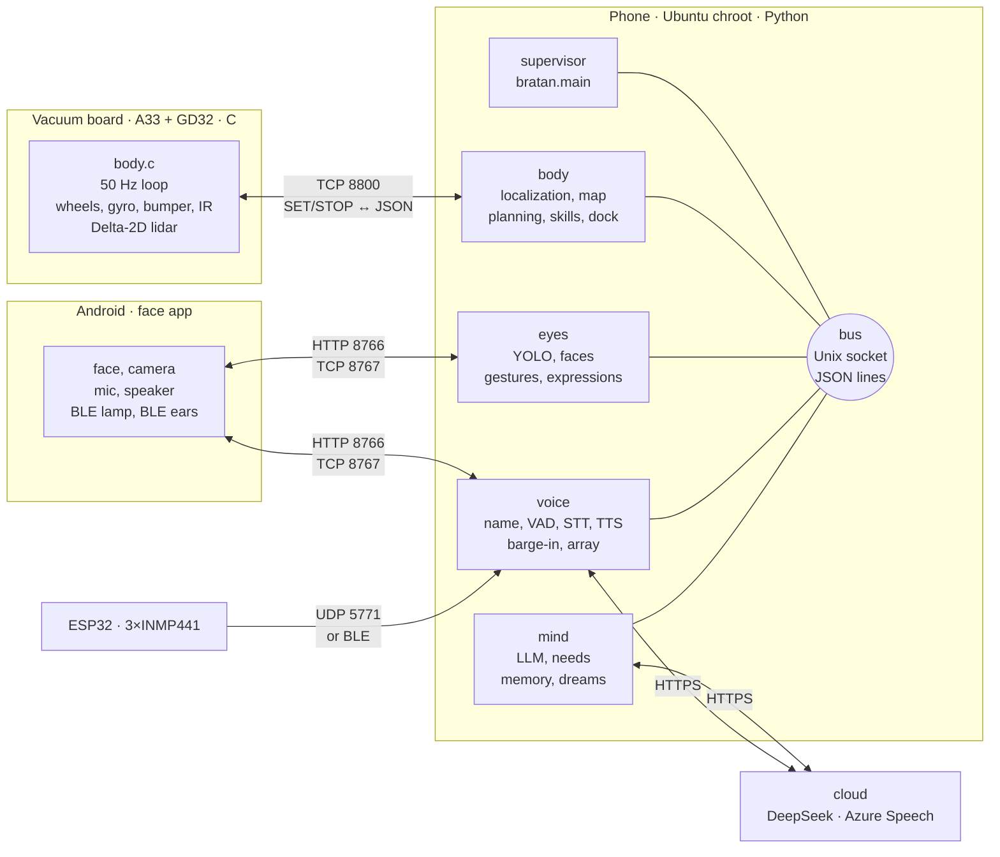

<div align="center">


# Bratan

**An autonomous home robot built on a used robot-vacuum chassis, with an Android phone instead of a computer and a 3D-printed corgi body.**
Lidar mapping and localization, path planning and docking, YOLO vision, a voice you can interrupt, an ESP32 microphone array, and an LLM "mind" with needs, memory and dreams.

[](brain)
[](board)
[](ears)
[](face)
[](body)
[](brain/tests)
[](LICENSE)

[Making-of video](https://www.youtube.com/@explAIn_ru) · [Русский](README.md) · [Architecture](#architecture) · [Setup](#setup) · [Limitations](#limitations)

</div>

Built in 10 weeks (August–October 2026). Hardware, assembly, testing and the robot's character are the author's; the code was written by the AI coding assistants [Codex](https://openai.com/codex) and [Claude Code](https://claude.com/claude-code).
Everything is tuned to one robot in one home, so treat it as a set of working parts rather than a kit. Code comments and the robot's speech are in Russian.

<table>
<tr>
<td width="33%"></td>
<td width="33%"></td>
<td width="33%"></td>
</tr>
<tr>
<td align="center">Navigates its home map on its own</td>
<td align="center">Detects people and the dog</td>
<td align="center">State as light: listening / thinking / speaking</td>
</tr>
</table>

## Specs

| | |
|---|---|
| Chassis | Xiaomi Mi Robot Vacuum-Mop P (STYTJ02YM), CRL-200S platform, differential drive |
| Body | 409 × 234 mm (286 mm across the ears), 199 mm tall, 236 mm with the lidar |
| Speed | up to 0.24 m/s, turning up to 0.6 rad/s |
| Compute | Allwinner A33 (vacuum board, real time) + Snapdragon 845, 8 GB (Meizu 16th phone, Ubuntu chroot) |
| Lidar | Delta-2D, 360 beams/rev, 0.2–8 m, ~6 rev/s |
| Map | 5 cm occupancy grid, rooms and doorways as a label raster |
| Localization | Gauss–Newton on a wall distance field, every scan, ~2 ms |
| Planner | 8-connected A\* with a tightness penalty + Hybrid-A\* for manoeuvres |
| Vision | YOLO26n at 320 px, ~10 fps on 3 cores; faces with YuNet + SFace |
| Voice | Vosk (name) → Silero VAD → Azure STT → LLM → Azure TTS; barge-in |
| Ears | ESP32 + 3 × INMP441, 16 kHz, direction of arrival (mean error ~16°) |
| LLM | DeepSeek V4.1 Flash via OpenRouter, ~$2/month |
| Cost | ≈ $80 without the printer (vacuum $50, the phone was already there) |
| Tests | 4,877 (pytest) + 15 real-time simulator scenarios; 167 run without the author's home map |

## Hardware

 

| Part | Component | Qty | Price | Role |
|---|---|---:|---:|---|
| Chassis | Xiaomi STYTJ02YM, used | 1 | $50 | wheels with encoders, gyro, bumpers, IR, lidar, battery, charging dock |
| Spinal cord | vacuum board: Allwinner A33 + GD32 MCU | — | — | rooted; runs [`board/body.c`](board) instead of the cleaning firmware |
| Head | Meizu 16th (Snapdragon 845), cracked screen | 1 | owned | camera, mic, speaker, face screen, Wi-Fi, compute |
| Ears | ESP32-WROOM-32 DevKit (NodeMCU-32S) | 1 | ~$2 | I2S array, UDP/BLE stream |
| Ears | INMP441 I2S microphone | 3 | ~$1 | direction of arrival, far-field speech |
| Light | BLE lamp (Zengge / ELK-BLEDOM) | 1 | $3 | state colour |
| Cooling | fan | 1 | $2 | the phone runs hot |
| Body | PLA, white and orange | ~2 spools | $20 | 25 parts, Anycubic Kobra 3 |

Ears wiring is an interactive 3D walkthrough, [`ears/provodka-bratana.html`](ears/provodka-bratana.html); microphone placement in the body is [`ears/korpus/index.html`](ears/korpus/index.html).

## Architecture



Fast things run locally, slow things in the cloud. The board keeps the motors and the emergency stop without the phone, the phone keeps the map, the path and vision without the cloud, and the language model decides *what* to do every few seconds.

| Process | Where | Cores | Rate | Job |
|---|---|---|---|---|
| `body.c` | board | — | 50 Hz | wheel speeds, gyro, command watchdog, lidar parsing |
| `body` | phone | 4–5, nice −10 | 50 Hz, skills 25 Hz | board link, pose, localization, map, path, skills, guard |
| `eyes` | phone | 5–7 | 0.2–12 fps | camera, detector, faces, tracking, gestures, trip videos |
| `voice` | phone | 4–5 | 16 kHz stream | name, VAD, recognition, synthesis, barge-in, array |
| `mind` | phone, in the supervisor | 0–3 | 10 Hz loop, event-driven thoughts | needs, LLM, memory, talk, games, dreams |

**Bus** ([`bratan/common/bus.py`](brain/bratan/common/bus.py)): Unix socket `/run/bratan/bus.sock` (0600), one JSON line `{"t": topic, "d": data}` per message, prefix subscriptions.
`*.state` topics are retained and replayed to new subscribers. A slow client is dropped instead of stalling the others; 5 s pings, reconnect after 15 s of silence.
The supervisor restarts a crashed process after `min(30, 0.5·2^n)` s.

## How it works

### Vacuum board — [`board/`](board)

A single dependency-free C process owns both UARTs: GD32 (`/dev/ttyS3`, 115200) and the lidar (`/dev/ttyS1`).
Every 20 ms it sends wheel speeds with an acceleration limit, uses the gyro to finish slow pivots, and holds heading.
The phone connects on TCP 8800: `AUTH <64 hex>`, then `SET <seq> <v> <w> <hold> <heading> <lidar_pwm>`. Replies are JSON `body` frames at 50 Hz and a `scan` per lidar revolution.
No command for 0.75 s stops the wheels; 5 s turns the lidar off. No cleaning, brush or water commands are ever sent. The wire format was checked against [VacuumTiger/sangam-io](https://github.com/codetiger/VacuumTiger).

### Body — [`brain/bratan/body/`](brain/bratan/body)

- **Link** (`link.py`): a command every 40 ms while moving, once a second when parked; 0.25 s command lease; board clock offset from the minimum-RTT sample. Body data older than 0.2 s or a scan older than 1 s stops the robot.
- **Map** (`grid.py`): 5 cm occupancy. Structural walls +5, floor −5; a lidar ray lowers cells by 2 and raises its end cell by 3, so moved furniture appears and disappears within a few scans. Localization uses only the structural walls.
- **Localization** (`localize.py`): Gauss–Newton on a distance field (capped at 0.5 m) with an analytic Jacobian and Huber weights; 240 points, up to 12 iterations, a ±8 cm / ±0.12 rad trust region. A scan is accepted when the mean residual is < 14 cm and ≥45 % of points lie within 10 cm of a wall. Four misses in a row mean "lost": 12 headings on the spot, then a global search over a 20 cm × 10° grid within 6 s, rejecting ambiguous poses. On the dock, point-to-plane ICP over a panorama with three agreeing fits.
- **Path** (`planner.py`, `maneuver.py`): 8-connected A\*, cost `1 + 8·tightness²`, corner-cutting smoothing. A doorway is a pinch < 0.46 m with a width of 0.42–1.15 m. Tight spots use Hybrid-A\*: 4 cm cells, a ±1.8 m window, 24 headings. Narrow doorways with a threshold are driven along a line the owner taught by placing the robot by hand (`passages.json`): ±1 cm, up to three tries reversing back.
- **Skills** (`skills.py`, 15): `rotate`, `drive`, `wait`, `go`, `go_room`, `approach`, `undock`, `dock`, `look_around`, `track`, `explore`, `relocalize`, `dance`, `emote`, `perform`. Driving is pure pursuit along the route.
- **Docking**: staging point → align (0.035 rad) → reverse ≤0.08 m/s → press at 0.05 m/s for 1.2 s → charging must hold for 3 s, then again with the lidar off. Up to three retries at ±4 cm offsets. The dock pose is checked against the live map before it is trusted.
- **Doors** (`doors.py`): ≥3 returns deeper than 0.5 m in the next room mean open; ≥4 on the doorway band and none beyond mean shut. A state changes only after a second sighting ≥0.8 s later.
- **Guard** (`guard.py`): the footprint swept along the trajectory at 0.1 / 0.25 / 0.45 / 0.7 s; a 1.5 cm pivot margin; 3 s point memory; camera obstacles; after a bumper hit only a straight retreat is allowed.

### Eyes — [`brain/bratan/eyes/`](brain/bratan/eyes)

NV21 frames (480×640) come from the Android app over HTTP with sensor timestamps; the frame rate follows the mode: 12 / 8 / 6 / 2 / 0.2 fps.
The detector is `yolo26n-track320.onnx` on ONNX Runtime CPU, 3 threads, ~50 ms; NMS 0.6, person threshold 0.45. YOLO26n 640 and YOLOE-26n run on request to survey objects.
Faces: YuNet + SFace, cosine ≥0.40 with a 0.05 margin, every 0.25 s; new angles are learned automatically (up to 20, at most one per 30 s). Tracking is greedy IoU > 0.3, and names stick to tracks.
Gestures come from `yolo26n-pose` (wave, hands up), facial expression from FER+ (8 classes). Trip videos are recorded by the phone as H.264 720p30.

### Voice — [`brain/bratan/voice/`](brain/bratan/voice)

```
mic 16 kHz ─► Vosk "Bratan" (grammar, 80 ms) ─► Silero VAD v6 ─► Azure STT (streamed) ─► mind ─► Azure TTS ─► speaker
     ▲                                                                                              │
     └──── ESP32: direction, best mic, RobotNull cancels its own voice ◄──── barge-in (Azure, 2 s windows) ◄┘
```

- **Name**: Vosk ru with a small grammar (variants of "Bratan", stop phrases, sound-alikes), 1.2 s pre-roll; a second, open decoder confirms it is an address.
- **Recognition**: Azure Speech REST, ru-RU, WAV uploaded in chunks while the person speaks; text is ready ~0.1 s after the phrase ends. Vosk is the offline fallback.
- **Synthesis**: Azure `ru-RU-DmitryNeural` (+8 %), two warm connections, the first clause requested in parallel, first audio in 0.15–0.7 s. Fallbacks: Edge TTS, offline Piper `ru_RU-irina-medium`.
- **Barge-in** (`overme.py`): while the robot speaks, 2 s windows go to recognition every 1.2 s. "Stop" means silence; "Bratan" or "wait" means silence and listen; two or more words that are not its own count as an interruption. Its own words are filtered by comparison with what it just said.
- **RobotNull** (`nullvoice.py`): a spatial null on the robot's own voice. STFT 512/256, a 3×3 covariance of its voice per frequency (~4 s memory), and the eigenvector with the smallest eigenvalue as the filter. The robot's voice drops 11–12 dB, a person gains 8–12 dB.
- **Direction** (`array.py`): GCC-PHAT delays at syllable onsets only (the precedence effect), 300–3500 Hz, matched to a diffraction model of the box-shaped body. Measured on 8 of 8 sides: 4–33° error, ~16° mean.
- **Sounds** (`sounds.py`): YAMNet (521 classes) on 0.975 s windows, 18 sound kinds with their own thresholds, and a startle reflex on a sudden jump in level.

### Ears — [`ears/`](ears)

ESP32 (Arduino, PlatformIO), firmware `ushi-24`.
Two I2S buses share a clock (SCK 26, WS 25, SD 33 and 32): I2S0 is master, I2S1 slave, both started inside one critical section. 16 kHz, 32-bit slots (24-bit data), 60 Hz Butterworth high-pass, 4-bit IMA-ADPCM.

| Channel | Format |
|---|---|
| UDP 5771 commands | `ping`, `sub`, `subv`, `suba`, `subm`, `unsub`, `health`, `pins`, `raw`, `restart`; renew a subscription within 3 s |
| `BRV1` / `BRM1` | 20-byte header: tag, seq, first frame, 512 frames (32 ms), codec, slot/mask, epoch, channels; ~25 KB/s for three channels |
| `BRE1` | raw 4 × int16 stream for debugging |
| BLE GATT | service `6b9c0001-…`, NOTIFY `…0002`, key `…0003`; MTU 517; a wrong token is disconnected at once |

Wi-Fi is provisioned through the `Bratan-Ushi` access point (WiFiManager) or WPS. Watchdogs reconnect Wi-Fi after 15 s, reboot after 10 min offline and restart on a wedged BLE stack; OTA rolls back unless the new image keeps Wi-Fi for 60 s.
When Wi-Fi drops packets, audio goes over BLE through the phone app to `127.0.0.1:5772`.

### Mind — [`brain/bratan/mind/`](brain/bratan/mind)

 

- **Event-driven thinking** (`brain.py`): 30 urgent events wake it at once (seeing the dog, being spoken to, a bump, low battery). Otherwise a heartbeat every 40 s with people, 60 s alone, up to 30 min dozing on the dock. One call returns one JSON: `thought`, `say`, `do`, "if…" conditions, `face`, `sound`; up to 500 tokens, temperature 0.85.
- **Actions**: 21 body actions (`go`, `approach`, `search`, `to_sound`, `photo`, `dance`, …) and 17 mind actions (`recall`, `note`, `want`, `plan`, `new_skill`, `learn_face`, `timer`, `web`, …). Plain commands ("stop", "go home") bypass the model.
- **LLM** (`llm.py`): OpenAI-compatible API; main model `deepseek-v4.1-flash`, fallbacks `deepseek-v4-pro` and `claude-haiku-5.5`. Streaming only, an 8 s stall cut-off, three keep-alive connections, prompt ordered for prefix caching. Web search through the OpenRouter plugin, up to 30 queries a day.
- **Needs** (`drives.py`): curiosity, knowing the home, missing the household, missing the dog, confidence, rest, wanting attention — passed to the model as words. Ideas from Kismet, MicroPsi, D2A (ICLR 2025), Generative Agents, Anki Vector, aibo and LOVOT.
- **Mood** (`affect.py`): valence × arousal, half-lives of 20 and 8 min, ~30 event impulses.
- **Memory** (`memory.py`): a JSON state (thoughts, wants, plans, skills, self-description) and SQLite WAL: events, objects with places, sightings. The diary and the day summary come from it.
- **Dreams**: once a night on the dock (01:00–06:00), 12 dream kinds, two old memories, and a rule not to repeat the last six. Traits drift by at most 0.03 a night; reflection every 3 hours on the dock.
- **Life** (`life.py`): 2 idle minutes — pick something to do; 2 more — go home. Battery < 15.0 V for 10 s — dock; may leave again from 16.3 V. Quiet hours 23:00–10:00.
- **Games**: hide and seek, red light / green light, photo booth, high five, delivery, wake-up, timer, album.

### Face — [`face/`](face)

Android app `ai.robotbrain.face` (minSdk 27, target 35), started at boot as the home screen.

- HTTP server on `127.0.0.1:8766` only: camera, audio, screen, lamp, photo. Per-scope tokens compared by SHA-256; requests with `Origin` are refused.
- TCP `127.0.0.1:8767`: frames `[type u8][len u32][payload]` — 20 ms mic frames with timestamps, PCM to the speaker.
- Camera: Camera2, front, 640×480 YUV, 0.2–15 fps; trip recording H.264 4 Mbit/s + AAC.
- Mic: `VOICE_RECOGNITION`, 16 kHz, the phone's NS and AEC, a 12 s ring buffer.
- Face: 14 states, five emotion sources (body, voice, event, reaction, direct) with their own lifetimes, blinks including partial ones, eight corgi poses.
- Lamp: BLE Zengge Telink mesh (AES) and ELK-BLEDOM, colour by state, a teal pulse on the dock.
- BLE ears bridge: GATT subscribe, token write, packet reassembly, reconnect after 3 s of silence.

### Learning to drive — [`training/`](training)

An MLP 228 → 128 → 128 → 64 → 2 over three lidar views (now, −0.3 s, −2 s) and 5 local-path points. Imitation of a geometric teacher (96,000 samples), then PPO: 12 environments, 1,228,800 steps. Best model: 120/120, 116/120 and 119/120 arrivals with no obstacles, static obstacles and a standing person.
It was trained on the author's home map; the repository ships a synthetic 10 × 7 m flat instead (`training/make_map.py`).
On the real robot the wheels are driven by pure pursuit; the network is loaded but issues no commands.

## Ports and protocols

| Port | Listener | Protocol |
|---|---|---|
| TCP 8800 | board | `AUTH`, `SET`, `STOP` → JSON `body` at 50 Hz, `scan` |
| `/run/bratan/bus.sock` | supervisor | bus, JSON lines, pub/sub |
| TCP 127.0.0.1:8766 | Android app | HTTP + bearer tokens |
| TCP 127.0.0.1:8767 | Android app | binary audio frames |
| UDP 5771 | ESP32 | commands and `BRV1`/`BRM1`/`BRE1` streams |
| UDP 127.0.0.1:5772 | voice | ear packets through the BLE bridge |

## Repository

| Folder | Language | Contents |
|---|---|---|
| [`board/`](board) | C | vacuum-board program: motors, gyro, lidar, watchdog, TCP |
| [`brain/`](brain) | Python | phone: bus, `body`, `eyes`, `voice`, `mind`, face client, tests, deploy |
| [`ears/`](ears) | C++ / Python | ESP32 firmware, array tools, wiring guide |
| [`face/`](face) | Java | Android app: face, camera, mic, speaker, BLE |
| [`body/`](body) | STL / GLB | R5 body: assembly and 25 printable parts |
| [`training/`](training) | Python | simulator and driving-policy training |
| [`docs/media/`](docs/media) | — | images for this page |

## Setup

1. **Chassis.** Root the CRL-200S (not every revision: the eighth bricks when rooted), stop the cleaning services, build and run `board/body.c` — see [`board/README.md`](board/README.md).
2. **Phone.** Rooted Android with an Ubuntu chroot. A Python environment at `/opt/robotbrain/venvs/perception` with [`brain/requirements.txt`](brain/requirements.txt), models in `MODELS` (listed below).
3. **Keys.** Files in `/opt/robotbrain/secrets` (or `$BRATAN_SECRETS`): `openrouter-api-key` or `deepseek-api-key`, `azure-speech-key`, `azure-speech-region`, `integrated-body-key` (the board key), the app's `face-*-key` tokens. No keys are in the repository.
4. **Map.** Your own: `map.pgm` + `map.yaml` (ROS map_server format, 5 cm), `rooms.json` with room names and `rooms-labels.npy` (a label raster of the same size) in `/opt/robotbrain/maps/home/`. The dock pose is `dock_pose` in `config.json`; taught doorways go in `bratan/body/passages.json`.
5. **Deploy.** `sh brain/deploy/push.sh` (needs an ssh host `phone`) installs a release in `/opt/robotbrain/bratan/releases/<time>`, flips the `app` symlink and keeps 5 releases. `safe_deploy.sh` installs only while the robot is parked and silent. `deploy/run.sh` is started by the Android boot hook.
6. **App.** `face/` is a Gradle project (AGP 8.6.1); release signing comes from `ROBOTBRAIN_ANDROID_*`, the ears token from `ROBOTBRAIN_EARS_TOKEN`.
7. **Ears.** `cd ears && python tools/flash.py usb`, then `python tools/flash.py ota`. The script creates the OTA password and BLE token in `.ota-pass` and `.ble-token`.

Control from a PC: `python -m bratan.cli tail body.` / `pub voice.say '{"text":"Привет"}'` / `autonomy on|off`.

### Models

Not included, except `actor.onnx`.

| Model | Task |
|---|---|
| `yolo26n-track320.onnx`, `yolo26n.onnx`, `yolo26n-pose.onnx`, YOLOE-26n | people, dog, objects, pose ([Ultralytics](https://github.com/ultralytics/ultralytics)) |
| YuNet 2023mar, SFace 2021dec | face detection and recognition ([OpenCV Zoo](https://github.com/opencv/opencv_zoo)) |
| `emotion-ferplus-8.onnx` | facial expression ([ONNX Model Zoo](https://github.com/onnx/models)) |
| `silero_vad_v6.onnx` | voice activity ([Silero VAD](https://github.com/snakers4/silero-vad)) |
| Vosk ru | the name "Bratan", offline recognition ([Vosk](https://alphacephei.com/vosk/models)) |
| YAMNet ONNX | sound classes |
| Piper `ru_RU-irina-medium` | offline synthesis ([Piper](https://github.com/rhasspy/piper)) |
| `brain/assets/navigation/actor.onnx` | driving policy, see [`training/`](training) |

## Tests

```bash
cd brain
pip install -r requirements.txt pytest
python -m pytest tests -q          # without a map: 167 passed, 9 skipped
python tests/run_sim.py            # real-time simulator
```

The author's home map is not published. Most tests (4,877 with the full map) and the simulator need a real map: put yours in `brain/tests/data` under the names in [`tests/conftest.py`](brain/tests/conftest.py) and they switch on. Without it, the map-independent tests run: bus, board link, voice, barge-in, array, sounds, faces, games.

`tests/sim.py` is a virtual board: 50 Hz differential drive with slip, ray-cast lidar on the map (σ 8 mm), bumper, springy dock contacts.
`run_sim.py` runs 15 scenarios: trip and dock, wrong dock pose, kidnapping, doors, a person in a doorway, a chair by the dock, contact bounce, a kitchen corner, passage retry, a chair behind, following round a corner, a performance, hands.
The driving policy has its own check: `cd training && python verify.py`.

## Limitations

- Long unattended life is not proven: the robot got stuck, mistook its dock, pushed its nose into a speaker and tried to leave 96 times in a row.
- The lidar sits 25 cm high and misses low things: it finds a book on the floor with its bumper.
- The phone-side guard has no cliff handling: the robot assumes a flat floor.
- False memories happened ("7 fridges", "14 beds", the dog filed as a cat); rules and thresholds keep them down.
- Calibrations are for one robot, and the map, rooms and taught doorways are for one home (not included). Another home needs its own.
- Talking and decisions need the cloud (LLM, Azure recognition and synthesis). Offline there are only the Vosk and Piper fallbacks, and plain commands ("stop", "go home") bypass the model.

## Timeline


| Date (2026) | Event |
|---|---|
| 10.08 | idea: a phone instead of a Raspberry Pi, a vacuum as the chassis |
| 12.08 | used vacuum, rooted the same day; first drive the next day — 0.5 cm |
| 15.08 | an AI calibrates the drive itself, watching the robot through a camera |
| 27.08 | 3D printer bought; corgi body from 12 white and 12 orange parts |
| 04.09 | found that the lidar is mounted rotated by 86° (1.5062 rad) |
| 06.09 | driving policy trained in simulation |
| 05–06.10 | switch to Claude Code, mind rewritten from scratch, home map, the name "Bratan" |
| 07.10 | first dream |
| 14–19.10 | ESP32 ears (one board burned), RobotNull, voice barge-in |

  

## Acknowledgements

- [VacuumTiger / sangam-io](https://github.com/codetiger/VacuumTiger) — CRL-200S protocol documentation.
- [Adafruit M4 Eyes](https://github.com/adafruit/Adafruit_Learning_System_Guides/tree/main/M4_Eyes) — eye textures (MIT), see [`THIRD_PARTY_NOTICES.md`](THIRD_PARTY_NOTICES.md).
- Kismet (MIT Media Lab), MicroPsi, D2A, Generative Agents, Anki Vector, Sony aibo, LOVOT — ideas for motivation.

## License

Code and body models — [MIT](LICENSE).
