<div align="center">

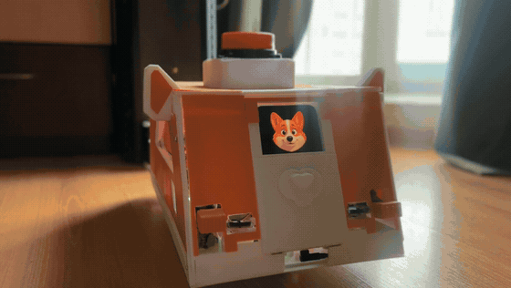

# Братан

**Автономный домашний робот на шасси б/у робота-пылесоса, телефоне Android вместо компьютера и 3D-печатном корпусе.**
Лидарная карта и локализация, планирование пути и стыковка с базой, зрение на YOLO, голос с перебиванием, микрофонная решётка на ESP32, «ум» на LLM с потребностями, памятью и снами.

<a href="README.md"></a>

[](brain)
[](board)
[](ears)
[](face)
[](body)
[](brain/tests)
[](LICENSE)

[Видео о создании](https://www.youtube.com/@explAIn_ru) · [3D-модель](#3d-модель) · [Архитектура](#архитектура) · [Запуск](#сборка-и-запуск) · [Ограничения](#ограничения)

</div>

> Скорее всего, это полнейшая хрень и вряд ли кому-то пригодится. Но мало ли.
> — автор

Робот собран за 10 недель (август–октябрь 2026). Железо, сборка, испытания и характер — автор; код писали ИИ-ассистенты [Codex](https://openai.com/codex) и [Claude Code](https://claude.com/claude-code).
Весь код заточен под один конкретный робот в одной квартире: это скорее набор работающих узлов, чем конструктор.

<table>
<tr>
<td width="33%">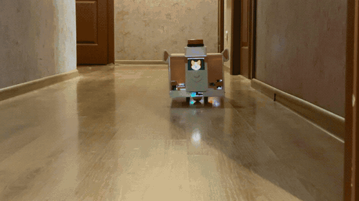</td>
<td width="33%">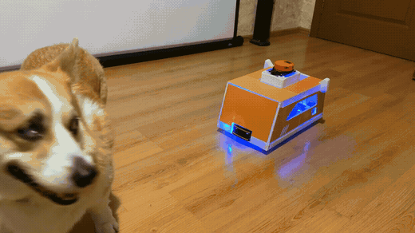</td>
<td width="33%">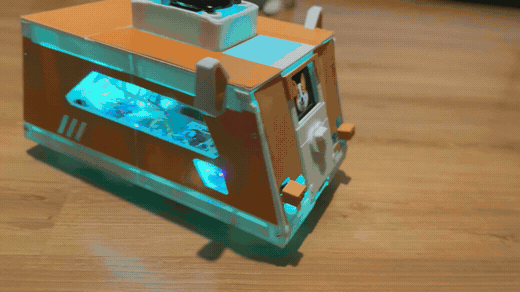</td>
</tr>
<tr>
<td align="center">Сам ездит по карте дома</td>
<td align="center">Детекция людей и собаки</td>
<td align="center">Состояние светом: слушаю / думаю / говорю</td>
</tr>
</table>

## Характеристики

| Параметр | Значение |
|---|---|
| Шасси | Xiaomi Mi Robot Vacuum-Mop P (STYTJ02YM), платформа CRL-200S, дифференциальный привод |
| Габариты корпуса | 409 × 234 мм (286 мм по «ушам»), высота 199 мм, с лидаром 236 мм |
| Скорость | до 0,24 м/с, разворот до 0,6 рад/с |
| Вычисления | Allwinner A33 (плата пылесоса, реальное время) + Snapdragon 845, 8 ГБ (телефон Meizu 16th, Ubuntu в chroot) |
| Лидар | Delta-2D, 360 лучей/оборот, 0,2–8 м, ~6 об/с |
| Карта | сетка занятости 5 см, комнаты и проёмы — растром меток |
| Локализация | Гаусс–Ньютон по полю расстояний до стен на каждом скане, ~2 мс |
| Планировщик | A\* по 8 соседям со штрафом за тесноту + Hybrid-A\* для манёвров |
| Зрение | YOLO26n 320 px, ~10 кадров/с на 3 ядрах; лица YuNet + SFace |
| Голос | Vosk (имя) → Silero VAD → Azure STT → LLM → Azure TTS; перебивание голосом |
| Уши | ESP32 + 3 × INMP441, 16 кГц, направление на голос (средняя ошибка ~16°) |
| LLM | DeepSeek V4.1 Flash через OpenRouter, ~$2 в месяц |
| Стоимость | ≈ $80 без принтера (пылесос $50, телефон уже был) |
| Тесты | 4 877 (pytest) + 15 сценариев в симуляторе реального времени; без карты квартиры автора доступны 167 |

## Железо

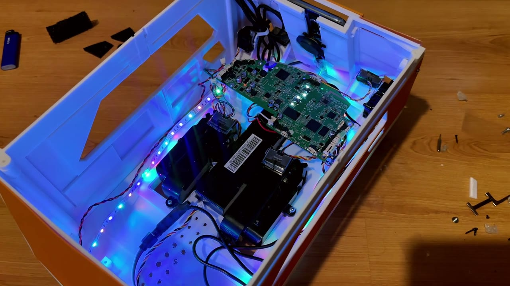 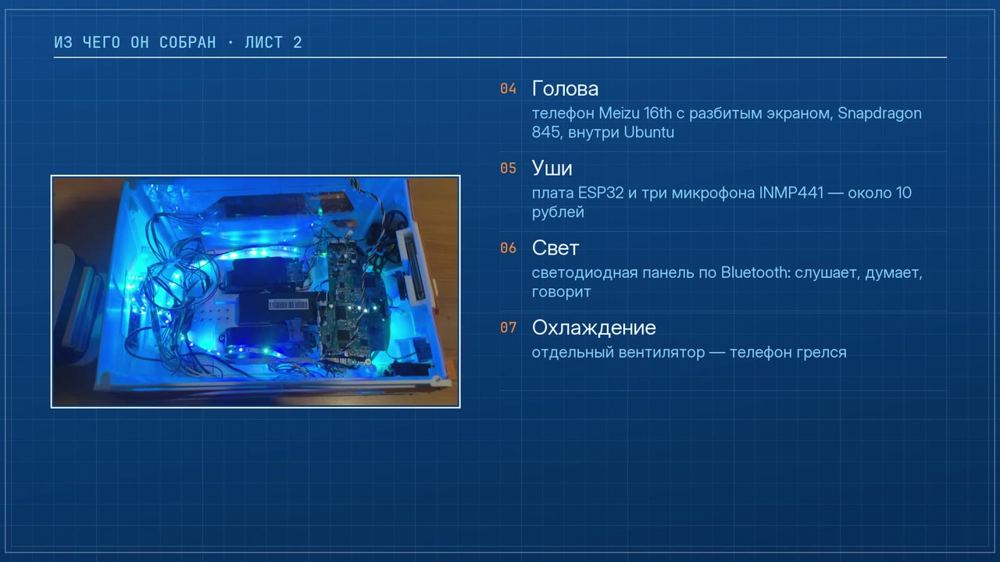

| Узел | Компонент | Кол-во | Цена | Роль |
|---|---|---:|---:|---|
| Шасси | Xiaomi STYTJ02YM, б/у | 1 | $50 | колёса с энкодерами, гироскоп, бамперы, ИК, лидар, батарея, зарядная база |
| Спинной мозг | плата пылесоса: Allwinner A33 + MCU GD32 | — | — | рут; своя программа [`board/body.c`](board) вместо прошивки уборки |
| Голова | Meizu 16th (Snapdragon 845), разбитый экран | 1 | было | камера, микрофон, динамик, экран-лицо, Wi-Fi, вычисления |
| Уши | ESP32-WROOM-32 DevKit (NodeMCU-32S) | 1 | ~$2 | I2S-решётка, UDP/BLE-поток |
| Уши | микрофон INMP441 (I2S) | 3 | ~$1 | направление на звук, речь издалека |
| Свет | BLE-лампа (Zengge / ELK-BLEDOM) | 1 | $3 | цвет состояния |
| Охлаждение | вентилятор | 1 | $2 | телефон греется |
| Корпус | PLA, белый и оранжевый | ~2 катушки | $20 | 25 деталей, Anycubic Kobra 3 |

Схема проводки ушей — интерактивная 3D-сцена [`ears/provodka-bratana.html`](ears/provodka-bratana.html), размещение микрофонов в корпусе — [`ears/korpus/index.html`](ears/korpus/index.html).

## 3D-модель

<div align="center">
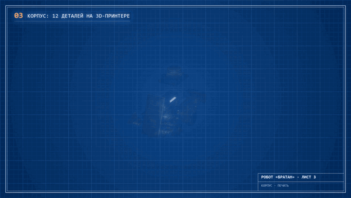
</div>

Корпус R5 спроектирован под шасси пылесоса и напечатан из PLA на Anycubic Kobra 3 (стол 250 × 250 мм): белый каркас и оранжевые накладки, которые дают облик корги, — уши на крыше, окно-мордочка под телефон, «лапки» на бамперах.
Файлы в [`body/`](body) — ровно то, что напечатано и стоит на роботе.

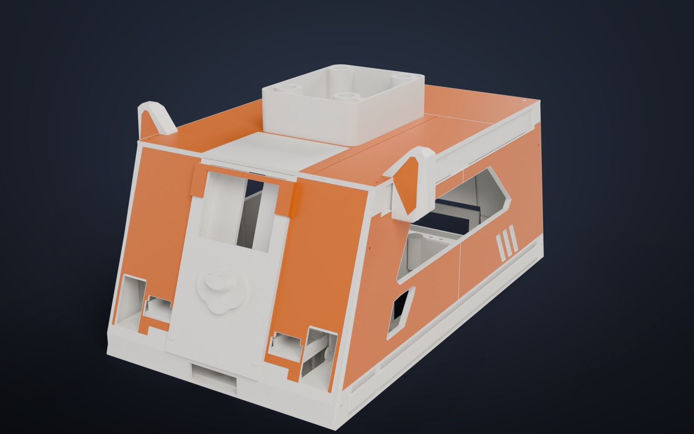 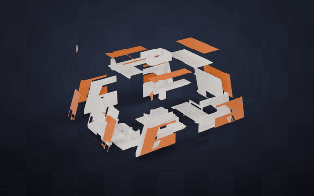

| | |
|---|---|
| Размер | 409 × 234 мм, по ушам 286 мм; высота до крыши 199 мм, с рамкой лидара 236 мм; дно на 23 мм выше пола |
| Белые детали (13) | дно из трёх частей, четыре боковые стенки, передняя и задняя стенки, три крышки, держатель лидара без дна |
| Оранжевые детали (12) | накладки боков, перёд из двух половин, зад, крыша, уши, задняя крышка |
| Сборка | на клей; держатель лидара вклеивается в окно крыши |
| Материал | PLA, около двух катушек |

- [`body/bratan_body_r5.stl`](body/bratan_body_r5.stl) — корпус в сборке; GitHub открывает его как интерактивную 3D-модель.
- [`body/print/white/`](body/print/white), [`body/print/orange/`](body/print/orange) — все детали, уже повёрнутые для печати (накладки лицом вниз).
- [`body/bratan_body_r5.glb`](body/bratan_body_r5.glb) — сборка в цвете для Blender и просмотрщиков glTF.

<div align="center">
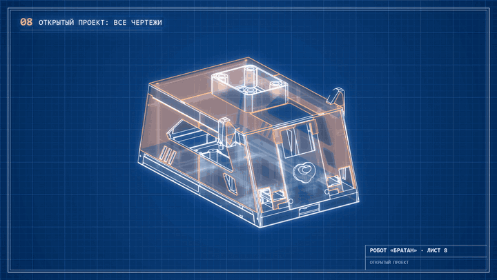
</div>

## Архитектура

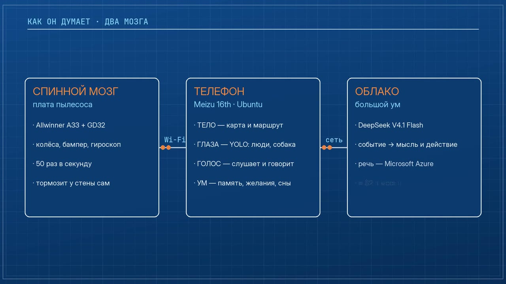

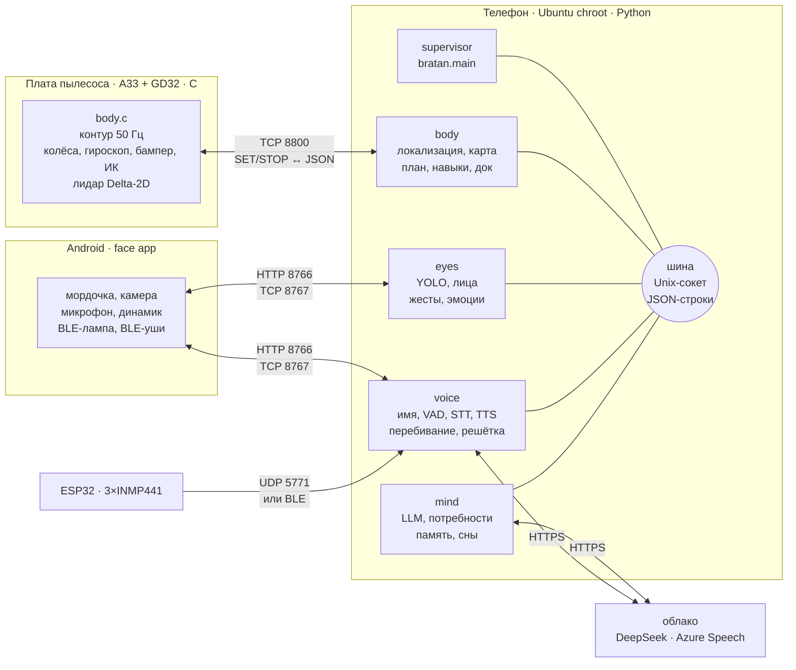

Быстрое — на месте, медленное — в облаке. Плата держит моторы и аварийную остановку без телефона, телефон держит карту, путь и зрение без облака, языковая модель решает, *что* делать, раз в несколько секунд.

| Процесс | Где | Ядра | Частота | Что делает |
|---|---|---|---|---|
| `body.c` | плата | — | 50 Гц | скорости колёс, гироскоп, сторож команд, разбор лидара |
| `body` | телефон | 4–5, nice −10 | 50 Гц, навыки 25 Гц | связь с платой, поза, локализация, карта, путь, навыки, защита |
| `eyes` | телефон | 5–7 | 0,2–12 кадров/с | камера, детектор, лица, трекинг, жесты, видео поездок |
| `voice` | телефон | 4–5 | поток 16 кГц | имя, VAD, распознавание, синтез, перебивание, решётка |
| `mind` | телефон, в supervisor | 0–3 | 10 Гц цикл, мысль по событию | потребности, LLM, память, разговор, игры, сны |

**Шина** ([`bratan/common/bus.py`](brain/bratan/common/bus.py)): Unix-сокет `/run/bratan/bus.sock` (0600), одна JSON-строка `{"t": топик, "d": данные}`, подписка по префиксу.
Топики `*.state` запоминаются и отдаются новым подписчикам. Медленный клиент отключается, а не тормозит остальных; пинг 5 с, переподключение через 15 с тишины.
Supervisor перезапускает упавший процесс с паузой `min(30, 0,5·2^n)` с.

## Как это работает

### Плата пылесоса — [`board/`](board)

Один процесс на C без зависимостей владеет обоими UART: GD32 (`/dev/ttyS3`, 115200) и лидаром (`/dev/ttyS1`).
Каждые 20 мс отправляет скорости колёс с ограничением ускорения, компенсирует медленный разворот по гироскопу, держит курс.
Телефон подключается по TCP 8800: `AUTH <64 hex>`, затем `SET <seq> <v> <w> <hold> <heading> <lidar_pwm>`. Ответ — JSON `body` 50 раз в секунду и `scan` на каждый оборот лидара.
Нет команды 0,75 с — колёса стоят; 5 с — гаснет лидар. Команд уборки, щёток и воды программа не шлёт никогда. Протокол сверен с [VacuumTiger/sangam-io](https://github.com/codetiger/VacuumTiger).

### Тело — [`brain/bratan/body/`](brain/bratan/body)

- **Связь** (`link.py`): команда раз в 40 мс в движении, раз в секунду на стоянке; аренда команды 0,25 с; смещение часов платы по минимальному RTT. Данные тела старше 0,2 с или скан старше 1 с — остановка.
- **Карта** (`grid.py`): занятость 5 см. Конструктивные стены +5, пол −5; луч лидара понижает клетки на 2, конец луча повышает на 3 — переставленная мебель исчезает и появляется за несколько сканов. Локализация смотрит только на конструктивные стены.
- **Локализация** (`localize.py`): Гаусс–Ньютон по полю расстояний (обрезка 0,5 м) с аналитическим якобианом и весами Хьюбера; 240 точек, до 12 итераций, доверительная область ±8 см / ±0,12 рад. Скан принят, если средняя невязка < 14 см и ≥45 % точек ближе 10 см к стене. Четыре промаха подряд — «потерялся»: 12 курсов на месте, затем глобальный поиск по сетке 20 см × 10° за 6 с с отказом от неоднозначных поз. На базе — ICP точка-плоскость по панораме, три согласных решения.
- **Путь** (`planner.py`, `maneuver.py`): A\* по 8 соседям, цена `1 + 8·теснота²`, сглаживание срезанием углов. Проём — сужение < 0,46 м шириной 0,42–1,15 м. В тесных местах — Hybrid-A\*: клетка 4 см, окно ±1,8 м, 24 курса. Узкие проёмы с порогом проезжаются по линии, которую автор показал, поставив робота руками (`passages.json`): ±1 см, до трёх попыток задним ходом.
- **Навыки** (`skills.py`, 15 шт.): `rotate`, `drive`, `wait`, `go`, `go_room`, `approach`, `undock`, `dock`, `look_around`, `track`, `explore`, `relocalize`, `dance`, `emote`, `perform`. Едет pure pursuit по маршруту.
- **Стыковка**: точка подготовки → выравнивание (0,035 рад) → задним ходом ≤0,08 м/с → поджатие 0,05 м/с 1,2 с → заряд должен держаться 3 с, затем ещё раз с выключенным лидаром. До трёх повторов со сдвигом ±4 см. Перед доверием к позе базы — проверка по живой карте.
- **Двери** (`doors.py`): ≥3 отражения глубже 0,5 м в соседней комнате — открыта; ≥4 на полосе проёма и ни одного за ней — закрыта. Смена состояния только после второго наблюдения через ≥0,8 с.
- **Защита** (`guard.py`): footprint, протянутый по траектории на 0,1 / 0,25 / 0,45 / 0,7 с; запас 1,5 см на развороте; память точек 3 с; препятствия с камеры; при касании бампера разрешён только отъезд назад.

### Зрение — [`brain/bratan/eyes/`](brain/bratan/eyes)

Кадр NV21 480×640 приходит из Android-приложения по HTTP с меткой времени сенсора. Частота кадров зависит от режима: 12 / 8 / 6 / 2 / 0,2 кадр/с.
Детектор `yolo26n-track320.onnx` на ONNX Runtime CPU, 3 потока, ~50 мс; NMS 0,6, порог человека 0,45. По запросу — YOLO26n 640 и YOLOE-26n для осмотра вещей.
Лица: YuNet + SFace, косинус ≥0,40 с запасом 0,05, раз в 0,25 с; новые ракурсы дообучаются сами (до 20, не чаще раза в 30 с). Трекинг — жадный IoU > 0,3, имя держится за трек.
Жесты — `yolo26n-pose` (помахать, руки вверх), выражение лица — FER+ (8 эмоций). Видео поездок — H.264 720p30 средствами телефона.

### Голос — [`brain/bratan/voice/`](brain/bratan/voice)

```
микрофон 16 кГц ─► Vosk «Братан» (грамматика, 80 мс) ─► Silero VAD v6 ─► Azure STT (потоком) ─► mind ─► Azure TTS ─► динамик
      ▲                                                                                                    │
      └──── ESP32: направление, лучший микрофон, RobotNull гасит свой голос ◄──── перебивание (Azure, окна 2 с) ◄┘
```

- **Имя**: Vosk ru с маленькой грамматикой (варианты «братан», «эй, братан», стоп-фразы, созвучия), предзапись 1,2 с; второй, открытый декодер подтверждает, что это обращение.
- **Распознавание**: Azure Speech REST, ru-RU, WAV отправляется кусками, пока человек говорит; текст готов через ~0,1 с после конца фразы. Офлайн-запас — Vosk.
- **Синтез**: Azure `ru-RU-DmitryNeural` (+8 %), два прогретых соединения, первая фраза запрашивается параллельно, первый звук через 0,15–0,7 с. Запасные: Edge TTS, офлайн Piper `ru_RU-irina-medium`.
- **Перебивание** (`overme.py`): пока робот говорит, окна по 2 с каждые 1,2 с уходят в распознавание. «Стоп», «хватит» — замолчать; «Братан», «подожди» — замолчать и слушать; два и больше чужих слова — перебили. Свои слова отсеиваются сравнением с только что сказанным.
- **RobotNull** (`nullvoice.py`): пространственный ноль на голос самого робота. STFT 512/256, для каждой частоты ковариация 3×3 своего голоса (память ~4 с), фильтр — собственный вектор с наименьшим собственным числом. Голос робота −11…−12 дБ, человек +8…+12 дБ.
- **Направление** (`array.py`): задержки GCC-PHAT только на началах слогов (эффект предшествования), 300–3500 Гц, сравнение с моделью дифракции на прямоугольном корпусе. Замер: 8 из 8 сторон, ошибка 4–33°, в среднем ~16°.
- **Звуки** (`sounds.py`): YAMNet (521 класс) окнами 0,975 с, 18 видов звуков со своими порогами; рефлекс испуга на резкий скачок громкости.

### Уши — [`ears/`](ears)

ESP32 (Arduino, PlatformIO), прошивка `ushi-24`.
Две шины I2S с общим тактом (SCK 26, WS 25, SD 33 и 32): I2S0 master, I2S1 slave, старт в одной критической секции. 16 кГц, слоты 32 бит (24 бит данных), ФВЧ Баттерворта 60 Гц, сжатие IMA-ADPCM 4 бит.

| Канал | Формат |
|---|---|
| UDP 5771, команды | `ping`, `sub`, `subv`, `suba`, `subm`, `unsub`, `health`, `pins`, `raw`, `restart`; подписка продлевается каждые ≤3 с |
| `BRV1` / `BRM1` | заголовок 20 байт: тег, seq, первый кадр, 512 кадров (32 мс), кодек, слот/маска, эпоха, каналы; ~25 КБ/с на три канала |
| `BRE1` | сырой поток 4 × int16 для отладки |
| BLE GATT | сервис `6b9c0001-…`, NOTIFY `…0002`, ключ `…0003`; MTU 517; без верного токена соединение рвётся сразу |

Wi-Fi настраивается через точку доступа `Bratan-Ushi` (WiFiManager) или WPS. Сторожа: переподключение Wi-Fi через 15 с, перезагрузка через 10 мин; перезапуск при зависшем BLE; OTA с откатом, если новая прошивка 60 с не держит сеть.
Когда Wi-Fi теряет пакеты, звук идёт по BLE через приложение телефона и обратно на `127.0.0.1:5772`.

### Ум — [`brain/bratan/mind/`](brain/bratan/mind)

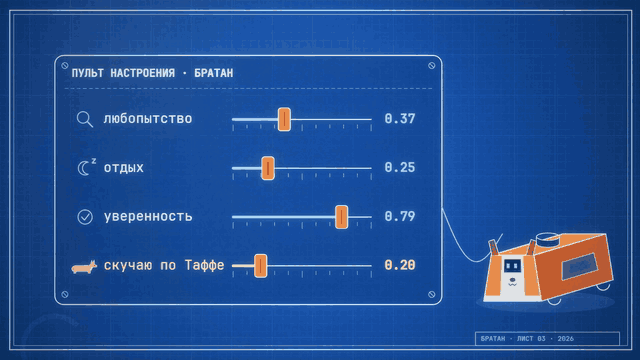 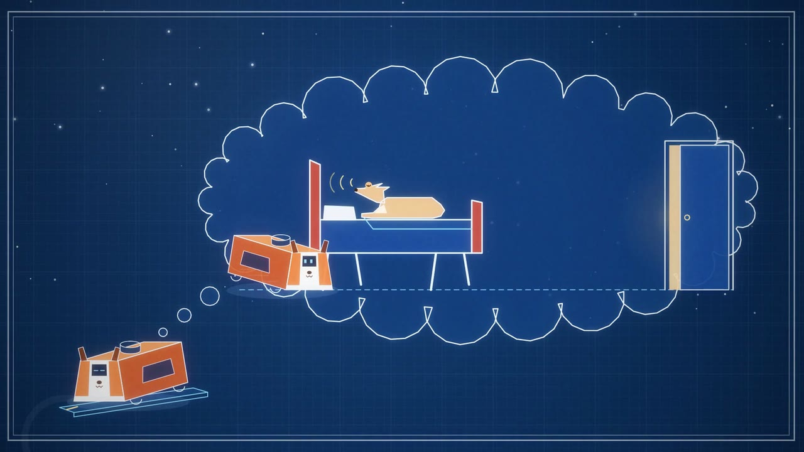

- **Мышление по событиям** (`brain.py`): 30 срочных событий будят сразу (увидел Таффу, заговорили, удар, батарея). Без событий — пульс 40 с при людях, 60 с одному, до 30 мин в дрёме на базе. Один вызов — один JSON: `thought`, `say`, `do`, условия «если…», `face`, `sound`; до 500 токенов, temperature 0,85.
- **Действия**: 21 действие тела (`go`, `approach`, `search`, `to_sound`, `photo`, `dance`, …) и 17 действий ума (`recall`, `note`, `want`, `plan`, `new_skill`, `learn_face`, `timer`, `web`, …). Простые команды («стоп», «на базу») идут мимо модели.
- **LLM** (`llm.py`): OpenAI-совместимый API; основная `deepseek-v4.1-flash`, запасные `deepseek-v4-pro` и `claude-haiku-5.5`. Только потоковый ответ, обрыв через 8 с тишины, три постоянных соединения, порядок промпта под кеш префикса. Поиск в интернете — плагин OpenRouter, до 30 запросов в день.
- **Потребности** (`drives.py`): любопытство, знать дом, скучаю по своим, скучаю по Таффе, уверенность, отдых, хочу внимания. Уровни подаются модели словами. Источники идей: Kismet, MicroPsi, D2A (ICLR 2025), Generative Agents, Anki Vector, aibo, LOVOT.
- **Настроение** (`affect.py`): валентность × возбуждение, полураспад 20 и 8 мин, ~30 событийных толчков.
- **Память** (`memory.py`): JSON-состояние (мысли, желания, планы, навыки, «кто я») и SQLite WAL: события, предметы с местами, встречи. Отсюда дневник и сводка дня.
- **Сны**: раз за ночь на базе (01:00–06:00), 12 типов снов, два старых воспоминания и запрет повторять шесть последних. Черты характера смещаются максимум на 0,03 за ночь; рефлексия каждые 3 часа на базе.
- **Жизнь** (`life.py`): 2 минуты без дела — выбрать занятие, ещё 2 — домой. Батарея < 15,0 В 10 с — на базу; уезжать можно от 16,3 В. Тихие часы 23:00–10:00.
- **Игры**: прятки, «тише едешь», фотобудка, «дай пять», доставка, будильник, таймер, альбом.

### Лицо — [`face/`](face)

Android-приложение `ai.robotbrain.face` (minSdk 27, target 35), запускается при загрузке телефона вместо домашнего экрана.

- HTTP-сервер только на `127.0.0.1:8766`: камера, звук, экран, лампа, фото. Токены по областям доступа сравниваются по SHA-256; запросы с `Origin` отклоняются.
- TCP `127.0.0.1:8767`: кадры `[тип u8][длина u32][данные]` — микрофон 20 мс с меткой времени, PCM в динамик.
- Камера: Camera2, фронтальная, 640×480 YUV, 0,2–15 кадр/с; запись поездок H.264 4 Мбит/с + AAC.
- Микрофон: `VOICE_RECOGNITION`, 16 кГц, шумодав и эхоподавление телефона, кольцевой буфер 12 с.
- Мордочка: 14 состояний, пять источников эмоций (тело, голос, событие, реакция, прямой приказ) со своими сроками жизни, моргание с частичными морганиями, восемь поз корги.
- Лампа: BLE Zengge Telink mesh (AES) и ELK-BLEDOM, цвет по состоянию, бирюзовая пульсация на базе.
- BLE-мост ушей: подписка на GATT, запись токена, сборка пакетов, переподключение через 3 с тишины.

### Обучение езды — [`training/`](training)

MLP 228 → 128 → 128 → 64 → 2 по трём лидарным срезам (сейчас, −0,3 с, −2 с) и 5 точкам локального пути. Подражание геометрическому учителю (96 000 примеров), затем PPO: 12 сред, 1 228 800 шагов. Лучшая модель: 120/120, 116/120, 119/120 доездов в сценариях без препятствий, со статикой и со стоящим человеком.
Обучение шло на карте квартиры автора; в репозитории вместо неё синтетическая квартира 10 × 7 м (`training/make_map.py`).
Колёсами на живом роботе сейчас управляет pure pursuit, нейросеть загружена, но команд не выдаёт.

## Порты и протоколы

| Порт | Кто слушает | Протокол |
|---|---|---|
| TCP 8800 | плата | `AUTH`, `SET`, `STOP` → JSON `body` 50 Гц, `scan` |
| `/run/bratan/bus.sock` | supervisor | шина, JSON-строки, pub/sub |
| TCP 127.0.0.1:8766 | Android-приложение | HTTP + Bearer-токены |
| TCP 127.0.0.1:8767 | Android-приложение | бинарные кадры звука |
| UDP 5771 | ESP32 | команды и поток `BRV1`/`BRM1`/`BRE1` |
| UDP 127.0.0.1:5772 | voice | пакеты ушей через BLE-мост |

## Репозиторий

| Папка | Язык | Что |
|---|---|---|
| [`board/`](board) | C | программа платы пылесоса: моторы, гироскоп, лидар, сторож, TCP |
| [`brain/`](brain) | Python | телефон: шина, `body`, `eyes`, `voice`, `mind`, связь с лицом, тесты, деплой |
| [`ears/`](ears) | C++ / Python | прошивка ESP32, инструменты проверки решётки, схема проводки |
| [`face/`](face) | Java | Android-приложение: лицо, камера, микрофон, динамик, BLE |
| [`body/`](body) | STL / GLB | корпус R5: сборка и 25 деталей для печати |
| [`training/`](training) | Python | симулятор и обучение нейросети езды |
| [`docs/media/`](docs/media) | — | кадры для этой страницы |

## Сборка и запуск

1. **Шасси.** Рутовать CRL-200S (не каждая ревизия: восьмая при попытке рута окирпичивается), остановить службы уборки, собрать и запустить `board/body.c` — см. [`board/README.md`](board/README.md).
2. **Телефон.** Android с root и Ubuntu в chroot. Python-окружение `/opt/robotbrain/venvs/perception` с [`brain/requirements.txt`](brain/requirements.txt), модели — в `MODELS` (список ниже).
3. **Ключи.** Файлы в `/opt/robotbrain/secrets` (или `$BRATAN_SECRETS`): `openrouter-api-key` или `deepseek-api-key`, `azure-speech-key`, `azure-speech-region`, `integrated-body-key` (ключ платы), токены приложения `face-*-key`. В репозитории ключей нет.
4. **Карта.** Своя: `map.pgm` + `map.yaml` (формат ROS map_server, 5 см), `rooms.json` с именами комнат и `rooms-labels.npy` (растр меток того же размера) в `/opt/robotbrain/maps/home/`. Поза базы — `dock_pose` в `config.json`, заученные проёмы — `bratan/body/passages.json`.
5. **Деплой.** `sh brain/deploy/push.sh` (нужен ssh-хост `phone`) кладёт релиз в `/opt/robotbrain/bratan/releases/<время>` и переключает симлинк `app`, хранит 5 релизов. `safe_deploy.sh` ставит только когда робот стоит и не разговаривает. Запуск — `deploy/run.sh` из загрузочного хука Android.
6. **Приложение.** `face/` — Gradle-проект (AGP 8.6.1); подпись release берётся из `ROBOTBRAIN_ANDROID_*`, токен ушей — из `ROBOTBRAIN_EARS_TOKEN`.
7. **Уши.** `cd ears && python tools/flash.py usb`, дальше `python tools/flash.py ota`. Пароль OTA и токен BLE скрипт создаёт сам в `.ota-pass` и `.ble-token`.

Управление с ПК: `python -m bratan.cli tail body.` / `pub voice.say '{"text":"Привет"}'` / `autonomy on|off`.

### Модели

В репозиторий не входят, кроме `actor.onnx`.

| Модель | Задача |
|---|---|
| `yolo26n-track320.onnx`, `yolo26n.onnx`, `yolo26n-pose.onnx`, YOLOE-26n | люди, собака, вещи, поза ([Ultralytics](https://github.com/ultralytics/ultralytics)) |
| YuNet 2023mar, SFace 2021dec | детекция и узнавание лиц ([OpenCV Zoo](https://github.com/opencv/opencv_zoo)) |
| `emotion-ferplus-8.onnx` | выражение лица ([ONNX Model Zoo](https://github.com/onnx/models)) |
| `silero_vad_v6.onnx` | детектор речи ([Silero VAD](https://github.com/snakers4/silero-vad)) |
| Vosk ru | имя «Братан», офлайн-распознавание ([Vosk](https://alphacephei.com/vosk/models)) |
| YAMNet ONNX | классификатор звуков |
| Piper `ru_RU-irina-medium` | офлайн-синтез ([Piper](https://github.com/rhasspy/piper)) |
| `brain/assets/navigation/actor.onnx` | политика езды, см. [`training/`](training) |

## Тесты

```bash
cd brain
pip install -r requirements.txt pytest
python -m pytest tests -q          # без карты: 167 passed, 9 skipped
python tests/run_sim.py            # симулятор реального времени
```

Карта квартиры автора не публикуется. Большинству тестов (4 877 на полной карте) и симулятору нужна настоящая карта: положите свою в `brain/tests/data` под именами из [`tests/conftest.py`](brain/tests/conftest.py), и они включатся. Без неё идут тесты, не привязанные к карте: шина, связь с платой, голос, перебивание, решётка, звуки, лица, игры.

`tests/sim.py` — виртуальная плата: дифференциальный привод 50 Гц с проскальзыванием, лидар лучами по настоящей карте (σ 8 мм), бампер, пружинящие контакты базы.
`run_sim.py` гоняет 15 сценариев: поездка и стыковка, неверная поза базы, похищение, двери, человек в проёме, стул у базы, дребезг контактов, кухонный угол, повтор проезда, стул сзади, следование за углом, выступление, руки.
Обучение езды проверяется отдельно: `cd training && python verify.py`.

## Ограничения

- Долгая жизнь без присмотра не доказана: робот застревал, путал базу, упирался в колонку и 96 раз подряд пытался уехать.
- Лидар стоит на высоте 25 см и не видит низкое: книгу на полу он находит бампером.
- Защита на телефоне не учитывает обрыв (лестницу): робот рассчитан на ровный пол.
- Ложная память: были «7 холодильников», «14 кроватей» и пёс, записанный кошкой; лечится правилами и порогами.
- Калибровки сняты с одного робота, а карта, комнаты и заученные проезды — с одной квартиры (в репозиторий не входят). Под другой дом их нужно снять заново.
- Разговор и решения требуют облака (LLM, распознавание и синтез Azure). Офлайн есть только запасные Vosk и Piper, а простые команды («стоп», «на базу») обходят модель.

## История

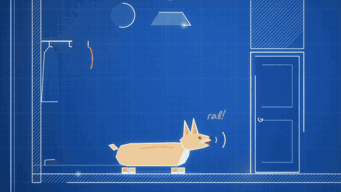

| Дата (2026) | Событие |
|---|---|
| 10.08 | идея: телефон вместо Raspberry Pi, шасси от пылесоса |
| 12.08 | б/у пылесос, в тот же день рут; на следующий день первый выезд — 0,5 см |
| 15.08 | ИИ сам калибрует привод, глядя на робота через камеру |
| 27.08 | куплен 3D-принтер; корпус-корги из 12 белых и 12 оранжевых деталей |
| 04.09 | найдено, что лидар повёрнут на 86° (1,5062 рад) |
| 06.09 | обучена нейросеть езды в симуляторе |
| 05–06.10 | переход на Claude Code, переписанный с нуля мозг, карта дома, имя «Братан» |
| 07.10 | первый сон |
| 14–19.10 | уши на ESP32 (одна плата сгорела), RobotNull, перебивание голосом |

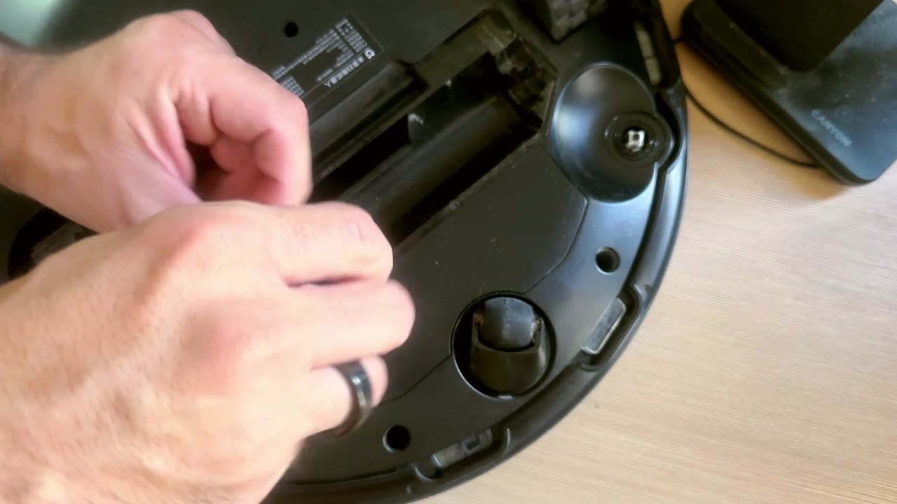 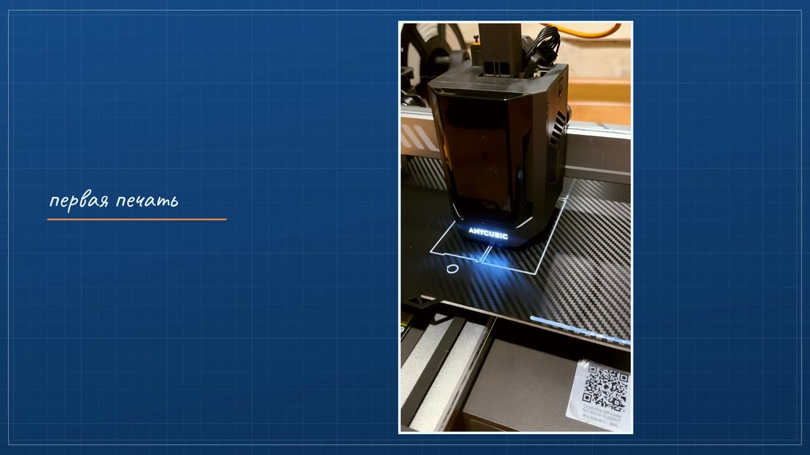 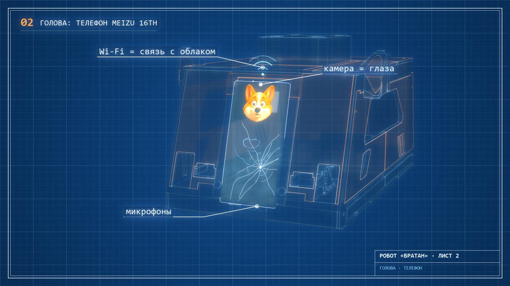

## Благодарности

- [VacuumTiger / sangam-io](https://github.com/codetiger/VacuumTiger) — документация протокола CRL-200S.
- [Adafruit M4 Eyes](https://github.com/adafruit/Adafruit_Learning_System_Guides/tree/main/M4_Eyes) — текстуры глаз (MIT), см. [`THIRD_PARTY_NOTICES.md`](THIRD_PARTY_NOTICES.md).
- Kismet (MIT Media Lab), MicroPsi, D2A, Generative Agents, Anki Vector, Sony aibo, LOVOT — идеи для мотивации.

## Лицензия

Код и модели корпуса — [MIT](LICENSE).
