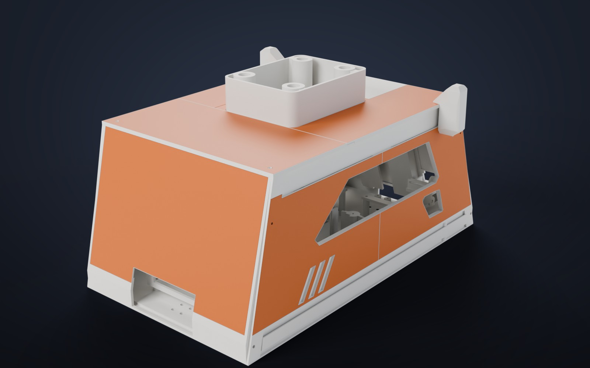
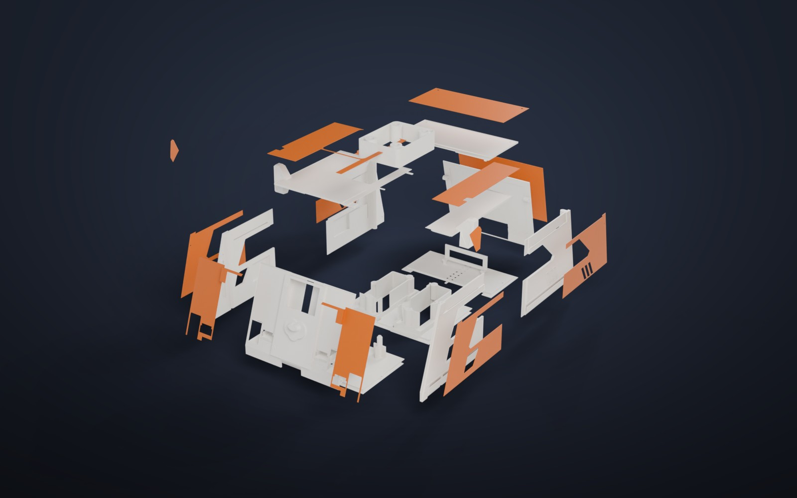

# Корпус R5

 

Корпус надевается на шасси робота-пылесоса Xiaomi STYTJ02YM (CRL-200S) и держит телефон-голову, лидар, уши и подсветку.
Облик — корги: уши сверху, мордочка-экран спереди, «лапки» на бамперах.

## Файлы

| Файл | Что |
|---|---|
| `bratan_body_r5.stl` | весь корпус в сборке, в миллиметрах. GitHub показывает его в 3D прямо в браузере |
| `bratan_body_r5.glb` | то же в цвете (белый и оранжевый), для Blender и просмотрщиков glTF |
| `print/white/01–12` | 12 белых деталей: три части дна, четыре боковые стенки, передняя и задняя стенки, три крышки |
| `print/white/13_lidar_carrier.stl` | держатель лидара без дна, вклеивается в окно крыши |
| `print/orange/01–12` | 12 оранжевых накладок: бока, перёд (две половины), зад, крыша, уши, задняя крышка |

Детали уже повёрнуты для печати; накладки лежат лицевой стороной на столе.

## Размеры

- Длина около 409 мм, ширина по стенкам 234 мм, по ушам 286 мм.
- Высота корпуса до крыши 199 мм, с рамкой лидара 236 мм.
- Дно корпуса на 23 мм выше пола.

## Печать

Печаталось на Anycubic Kobra 3 (стол 250×250 мм) пластиком PLA, белым и оранжевым — ушло около двух катушек.
Детали собираются на клей. Передняя оранжевая накладка из двух половин когда-то закрыла брак печати и осталась как дизайн.

Модель снята с одного конкретного пылесоса и одного телефона (Meizu 16th). Под другое железо придётся подгонять окна и крепления.
